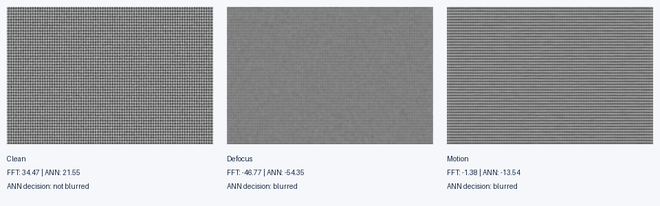
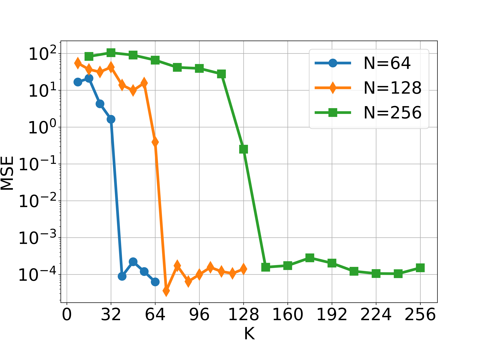
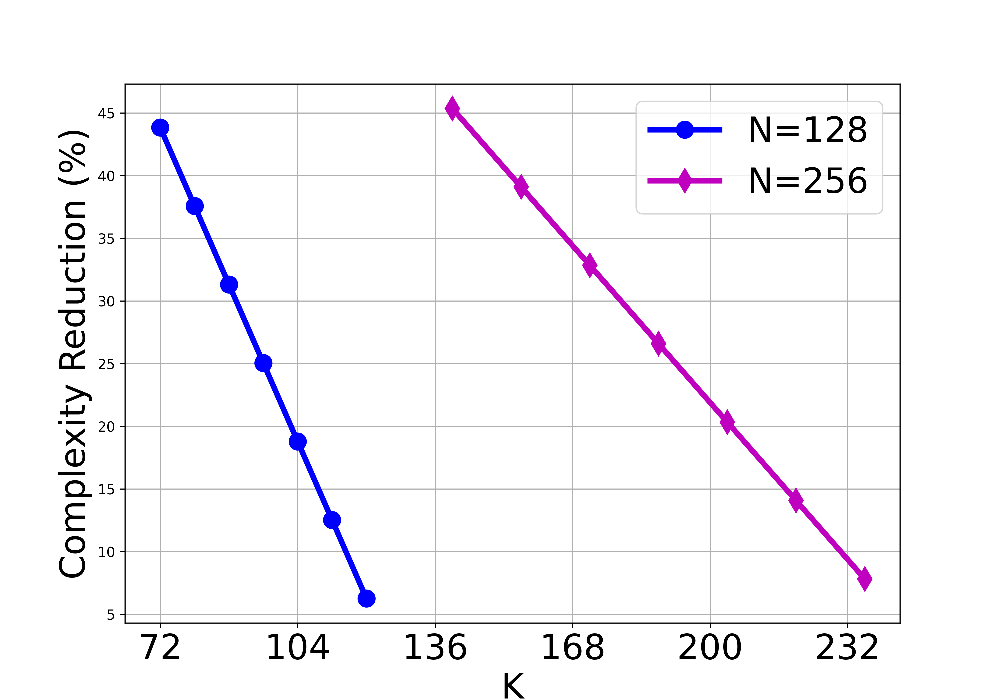

# Neural FFT Approximation for Image Blur Detection

**First-author research and original code by [Xinghao Wang](https://github.com/Russwang)** · IEEE ISSC 2025 · [Published paper](https://doi.org/10.1109/ISSC67739.2025.11291523)

[中文说明](README.zh-CN.md) · [Reproduction guide](docs/REPRODUCIBILITY.md) · [Research notes and limitations](docs/RESEARCH_NOTES.md)

Can a smaller neural approximation retain enough frequency information to detect image blur? This project studies that tradeoff with a **single hidden layer, linear activations, no biases**, and reduced hidden width. It connects transform approximation to blockwise blur detection on defocus and motion blur.

```text
Real signal (N) → Linear Dense (K < N) → Linear Dense (N) → Approximate FFT real part
Image → Grayscale blocks → Row/column transforms → High-pass reconstruction → Blur score
```

The published study reports **up to approximately 45% fewer operations compared with an untrimmed ANN**, with effective tested configurations of `N=128, K=72` and `N=256, K=144`. This is an arithmetic-count comparison within the ANN architecture; the paper does not establish a 45% runtime improvement over an optimized FFT.

## Quick start

Python 3.10 or newer. The lightweight demo reads the included pretrained HDF5 kernels directly; TensorFlow is only needed for training and the research notebooks.

```bash
git clone https://github.com/Russwang/approximate-blur-detection.git
cd approximate-blur-detection
python3 -m venv .venv
source .venv/bin/activate
python -m pip install -r requirements.txt
python scripts/demo.py
```

This creates synthetic clean, defocus-blurred, and motion-blurred images, then saves a comparison image and JSON report under `outputs/demo/`. No external dataset or retraining is required.



**The illustration is a new synthetic demo, not a reproduction of the paper's dataset results.** Its default `matched` calibration uses each method's score on the clean reference as its threshold. The JSON also records ANN decisions with the paper-style shared FFT threshold; that rule produces a false positive on the synthetic clean image. See [the calibration details](docs/REPRODUCIBILITY.md).

```bash
# Second configuration from the paper
python scripts/demo.py --n 256 --k 144 --output outputs/demo-256

# Compare the original FFT-threshold rule
python scripts/demo.py --calibration fft --output outputs/shared-threshold

# Evaluate your own aligned grayscale or color image pair
python scripts/demo.py --reference /path/to/clean.jpg --image /path/to/blurred.jpg

# Verify inference and edge cases
python -m unittest discover -s tests -v
```

## Research results

| Configuration | Hidden-width reduction | Arithmetic-count reduction vs. K=N |
| --- | --- | --- |
| N=128, K=72 | 43.75% | 43.84% |
| N=256, K=144 | 43.75% | 43.79% |

The percentages above are computed from the paper's addition/multiplication formula for one 1D ANN call. They exclude preprocessing, inverse FFT, memory traffic, and image I/O.




These are saved research plots supplied with the original experiment files. Their exact sweep settings differ from the paper tables in places; [the research notes](docs/RESEARCH_NOTES.md) explain the distinctions.

## What's included

| File or folder | Purpose |
| --- | --- |
| `blur_detection.py` | Validated HDF5 kernel loading, batched inference, block scores, operation counts |
| `scripts/demo.py` | Deterministic synthetic demo and custom image-pair evaluation |
| `scripts/train.py` | Parameterized TensorFlow training entry point |
| `BlurDetection_Train*.ipynb` | Original single-model and width-sweep training experiments |
| `BlurDetection_FFT*.ipynb` | Original FFT baseline experiments |
| `BlurDetection_XFFT*.ipynb` | Original neural-transform blur detection experiments |
| `MSE_XFFT_FFT.ipynb`, `CPLX_XFFT.ipynb` | Original approximation-error and arithmetic-count analysis |
| `model/` | Pretrained linear networks across transform sizes and hidden widths |
| `docs/` | Data setup, reproducibility instructions, and implementation limitations |

The original notebooks retain their code and have execution outputs cleared. They require dataset setup and path/parameter checks before running. The command-line demo is the supported quick-start path.

## Scope

The network learns `np.fft.fft(x).real`, not the full complex FFT or NumPy's packed `rfft`. Applying it along rows and columns does not recover all information in a complex 2D FFT. The study evaluates selected image scenarios and does not provide a large held-out accuracy benchmark or device latency measurements. The linear bottleneck has a rank limit and does not depend on a nonlinear universal-approximation argument. See [research notes](docs/RESEARCH_NOTES.md).

## Citation

Xinghao Wang, Lu Bai, Chongyan Gu, and Yun Wu. **Universal Approximated Real-Valued Fast Fourier Transform for Image Blur Detection.** IEEE ISSC, 2025. DOI: [10.1109/ISSC67739.2025.11291523](https://doi.org/10.1109/ISSC67739.2025.11291523).

Machine-readable citation metadata is in [CITATION.cff](CITATION.cff). Third-party dataset images are not redistributed; obtain them from the links in [DATA.md](docs/DATA.md). No open-source license is currently granted by this repository.
