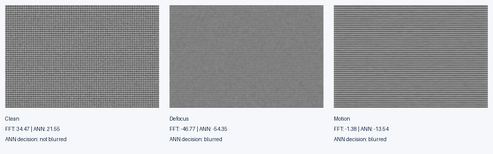

# 神经网络近似 FFT 与图像模糊检测

**代码作者、论文第一作者：王星皓（Xinghao Wang）** · IEEE ISSC 2025 · [论文链接](https://doi.org/10.1109/ISSC67739.2025.11291523)

[English](README.md) · [复现说明](docs/REPRODUCIBILITY.md) · [方法与限制](docs/RESEARCH_NOTES.md)

本项目研究：缩小神经网络的隐藏层后，近似 Fourier 变换能否保留足够的频域信息，用于区分清晰、散焦模糊与运动模糊图像？

研究采用单隐层、线性、无偏置网络，将 `N` 维实值信号映射到 `K` 维隐藏层，再输出 `N` 维变换近似。通过比较不同变换尺寸与隐藏层宽度的误差和运算量，再接入图像分块模糊检测，评估精度与计算成本的取舍。

论文报告：**相较隐藏层宽度 K=N 的未裁剪 ANN，运算量最高降低约 45%**。论文给出的有效配置为 `N=128, K=72` 和 `N=256, K=144`。该结果是 ANN 内部的理论运算量比较，不代表比优化 FFT 实测快 45%。

## 快速运行

使用 Python 3.10 或更新版本：

```bash
git clone https://github.com/Russwang/approximate-blur-detection.git
cd approximate-blur-detection
python3 -m venv .venv
source .venv/bin/activate
python -m pip install -r requirements.txt
python scripts/demo.py
```

默认演示直接读取已有模型的权重，无需安装 TensorFlow、重新训练或下载图片数据集。程序生成清晰、散焦、运动模糊的合成图像，并将对比图、评分和判定保存到 `outputs/demo/`。



**这是新增的运行演示，不是论文实验数据的复现。** 默认演示分别用各方法在清晰参考图像上的评分校准阈值。JSON 同时保留论文式共用 FFT 阈值的判定结果；共用阈值会把这张合成清晰图像误判为模糊。运行 `python scripts/demo.py --calibration fft` 可以直接观察这一限制。

```bash
python scripts/demo.py --n 256 --k 144 --output outputs/demo-256
python scripts/demo.py --reference /path/to/clean.jpg --image /path/to/blurred.jpg
python -m unittest discover -s tests -v
```

## 项目内容与贡献

- 原始研究实现：训练线性无偏置近似网络、隐藏层宽度扫描、FFT 对照、分块模糊检测、MSE 与运算量分析。
- 预训练模型：`model/` 下保留不同 N、K 配置的 HDF5 模型。
- 求职展示整理：补充轻量命令行入口、合成演示、中英文说明、正式论文引用、复现边界和推理检查。

原始 notebooks 保留研究代码，清除了旧执行输出。训练与 notebook 环境请参考 [复现说明](docs/REPRODUCIBILITY.md)。第三方数据集不随仓库分发，下载入口见 [数据说明](docs/DATA.md)。

## 结果边界

模型的训练目标是 FFT 的实部，不是完整复数 FFT，也不是 NumPy 的 `rfft` 输出。逐行逐列应用实部近似不能保留完整二维复数 Fourier 信息。线性瓶颈网络受矩阵秩限制；原论文仅评估选定场景，未报告大型独立测试集的总体准确率或真实设备上的延迟提升。

## 论文

Xinghao Wang, Lu Bai, Chongyan Gu, Yun Wu. **Universal Approximated Real-Valued Fast Fourier Transform for Image Blur Detection.** IEEE ISSC 2025. DOI: [10.1109/ISSC67739.2025.11291523](https://doi.org/10.1109/ISSC67739.2025.11291523)。

本仓库目前未授予开源许可证。
